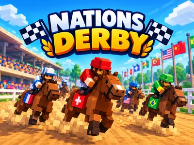

# Nations Derby - Interactive TikTok Live Game

> Your chat picks a country and gifts its horse to the finish.

Countries race blocky horses in 3D on your stream. Viewers join a country once, and every gift they send boosts its horse: gallops, sprints, Pegasus wings and Thunder Charges.

**[Play Nations Derby on Livecade](https://livecade.io/games/nations-derby/?utm_source=github&utm_medium=readme&utm_campaign=nations-derby)** - runs as a single browser source in OBS, Streamlabs, or TikTok LIVE Studio. Nothing for viewers to install.

## How viewers play

Viewers take part with the actions TikTok already gives them: **comments**, **gifts**, **likes**, **follows**. Every action below is rebindable, so you decide which interaction drives which effect.

| Action | What it does |
| --- | --- |
| **Join a team** | Puts the viewer on the country they type: a lane number or the country's name. Any comment that names one does it by default |
| **Trot** | A little extra pace for one second. 20 likes by default |
| **Gallop** | A faster second and a half, one hoofbeat per send. A Rose by default |
| **Sprint** | Three seconds at speed, throwing up clods of the track. A Finger Heart or a follow by default |
| **Pegasus** | The horse flies on wings for five seconds at double pace, with a rainbow behind it. A Hand Heart by default |
| **Thunder Charge** | Lightning strikes the horse and it charges for five seconds, the fastest run in the game. A Money Gun by default |

## How it works

### Pick a country once

A viewer types a lane number or a country's name and joins that country. Every gift and like they send afterwards boosts its horse, and a gift from a viewer with no country puts them on the one in last place.

### A ladder of boosts

A trot, a gallop, a sprint, Pegasus wings and a Thunder Charge, each faster and longer than the last. Every send is its own hoofbeat, flash or strike on screen, and a streak makes a boost last longer.

### Boosts only help

No gift slows another country. A gentle catch-up gives a horse behind the leader a little more from each boost, so races stay close.

### Winner's circle and wins

The first horse past the post wins. The top 3 stand in the winner's circle, the standings count each country's wins across your stream, and the next race starts, on a new map by default.

## About the game

Nations Derby turns your TikTok Live into a horse race between countries. Up to ten horses with blocky jockeys line up in front of the grandstand, each in its country's colors with its flag on the saddle cloth, and after 3, 2, 1 they race round an oval racecourse to the finish post. Viewers pick a side once, by typing the lane number or the country's name, and from then on everything they send powers that horse.

### One country, every gift

Joining is a comment: the lane number, the country's name in any of thirteen languages, its code or its flag emoji. After that a viewer's gifts and likes all go to their country, so you set up five gift triggers whatever the number of countries. Out of the box 20 likes give a trot, a Rose a gallop, a Finger Heart or a follow a sprint, a Hand Heart sends the horse flying on Pegasus wings and a Money Gun brings a Thunder Charge, a bolt of lightning and the fastest run in the game. Any other gift plays the boost for its price, so the same coins buy the same distance. A viewer who sends a gift before picking a country joins the one in last place.

### Nobody gets slowed down

Every boost helps only the sender's own horse, so a country can only win by out-cheering the others. A gentle catch-up gives the boosts of a horse behind the leader a little longer, so races stay close without the leader ever being slowed. Gifts sent before the start are saved and go off at GO.

### A broadcast camera

The camera films the race like a broadcast: the field side-on from the infield, and the whole field from behind every so often. A Pegasus or a Thunder Charge gets the camera: it flies to that horse and holds on the whole effect. A strip across the top shows every horse's place on the track, the standings show each country's viewers and this stream's wins, and a card with the sender's photo appears for each gift.

### Countries, colors or your own teams

Pick 2 to 10 countries in any order. For a room where everyone is from one country, race colors instead, or set up your own teams with their names, colors and pictures. The winner stands in the winner's circle with a flower blanket and the trophy, and the next race starts, on a new map by default.

## What it looks like on stream

[Watch Nations Derby gameplay](https://cdn.livecade.io/games/nations-derby.mp4)

## What you can configure

- **Language** - Thirteen languages for everything on screen, country and color names included
- **Teams** - Countries, colors, or your own teams with their names, colors and pictures, 2 to 10 lanes
- **Map** - Derby Day, Desert Dunes, Beach Sprint or Night Stadium, or a new map every race (the default)
- **Race length** - Short, medium or long: about 1, 2 or 3 minutes without boosts. Boosts make a race with gifts end sooner
- **Catch-up** - Off, gentle (the default) or strong: how much longer the boosts of a horse behind the leader run
- **Camera shows big boosts** - The camera flies to a Pegasus or a Thunder Charge and holds on the whole effect for about 6 seconds
- **Colors** - The accent, highlight and panel colors of everything on screen

## Languages

English, Spanish, Portuguese, French, German, Italian, Indonesian, Arabic, Turkish, Russian, Hindi, Romanian, Filipino

## FAQ

<strong>How do viewers join a country in Nations Derby?</strong>

They comment the lane number or the country's name, in any of the thirteen languages, or its flag emoji. They join once, and from then on everything they send goes to that country. A viewer who sends a gift before joining is put on the country in last place, so no gift is lost.

<strong>What do gifts do?</strong>

Out of the box 20 likes give a trot, a Rose a gallop, a Finger Heart a sprint, a Hand Heart Pegasus wings and a Money Gun a Thunder Charge. A follow gives a sprint, and any other gift plays the boost for its price. Every action can be rebound to any gift, or to comments, likes and follows.

<strong>Can a gift slow down another country?</strong>

No. Every boost only helps the sender's own horse. With the catch-up setting on, a horse behind the leader gets a little more from each boost, and the leader is never slowed.

<strong>My viewers are all from one country. Does it still work?</strong>

Yes. Switch Teams to colors and viewers race red against blue and the rest, or set up your own teams with their own names, colors and pictures.

<strong>Will Nations Derby run on my PC?</strong>

It renders in 3D on the computer running your stream, so give it a reasonably modern machine. Try it in the dashboard preview before you go live.

<strong>How do I add Nations Derby to my TikTok Live?</strong>

Add one browser source URL to OBS or TikTok LIVE Studio and go live. The game is a 9:16 vertical overlay, and there is no plugin or app to install.

## Setup

1. [Create a Livecade account](https://app.livecade.io/register?utm_source=github&utm_medium=cta&utm_campaign=nations-derby)
2. Copy your overlay browser source URL
3. Paste it into OBS, Streamlabs, or TikTok LIVE Studio
4. Pick Nations Derby, set your triggers, and go live

Runs in the browser, so it works on Windows and macOS with nothing to download. [See all TikTok Live games](https://livecade.io/tiktok-live-games/?utm_source=github&utm_medium=readme&utm_campaign=nations-derby).

---

_This repository documents Nations Derby, a hosted interactive game by [Livecade](https://livecade.io/?utm_source=github&utm_medium=footer&utm_campaign=nations-derby). The game runs on Livecade's platform, so there is no source to install here._
